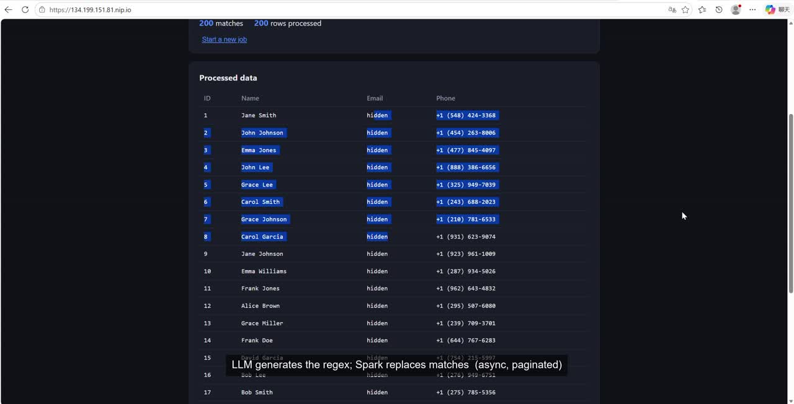

# Distributed NL-to-Regex Data Processing Platform

Connect to **your own Amazon S3 bucket**, load a CSV/Excel file, describe a text
pattern in **plain English**, and transform the matched data **at scale** — all
asynchronously, with progress you can watch live.

Built with **Django + DRF**, **Celery + Redis**, **PySpark**, an **LLM
(Anthropic Claude)**, and a **React** frontend. The whole stack comes up with a
single `docker compose up`.

> **Live deployment:** https://134.199.151.81.nip.io
> (Reviewers: connect with your own S3 bucket + credentials.)

---

## Demo

[](https://github.com/kevin-working303/distributed-nl-regex-platform/releases/download/v1.0/demo_final.mp4)

*Click the thumbnail to download/play the video.* It shows, in order: connecting
to a real S3 bucket with user-entered credentials, an async **Replace** job
redacting emails, an **Extract** job pulling the email domain into a new
column, a **Standardize** job normalizing phone numbers via LLM-derived rules,
and an LLM-powered partial in-cell mask (hides only the email username, keeps
the domain) — each with live job status and a generated regex/ruleset shown in
the UI.

---

## Table of contents
- [What it does](#what-it-does)
- [Architecture](#architecture)
- [Quick start](#quick-start)
- [Using the app](#using-the-app)
- [The three transformations](#the-three-transformations)
- [How scaling works (partitioning & parallelism)](#how-scaling-works-partitioning--parallelism)
- [Credential security](#credential-security)
- [LLM integration & regex safety](#llm-integration--regex-safety)
- [API reference](#api-reference)
- [Observability](#observability)
- [Testing](#testing)
- [Deployment](#deployment)
- [Trade-offs & notes](#trade-offs--notes)

---

## What it does

1. **Connect** — enter your AWS Access Key, Secret Key and bucket name. The app
   verifies the connection and lists the CSV/Excel files in **your** bucket. No
   pre-configured bucket, no hard-coded credentials, no fixed sample files.
2. **Describe** — pick a file, choose a target column (or columns), and describe
   the pattern in natural language ("find email addresses").
3. **Process** — an **LLM turns the description into a regex**, which is
   validated and cached in Redis, then a **Celery task applies it via a PySpark
   transformation** across partitions. The submit call returns **immediately**
   with a job ID.
4. **Watch & view** — the UI polls live status/progress; when the job finishes,
   the processed data is shown in a **paginated** table (never millions of rows
   at once).

### Example (from the brief)

| Input (`Email` column)      | NL request                                              | Regex the LLM produces                                  | Output      |
|-----------------------------|---------------------------------------------------------|---------------------------------------------------------|-------------|
| `john.doe@example.com`      | "Find email addresses … replace them with 'REDACTED'." | `\b[A-Za-z0-9._%+-]+@[A-Za-z0-9.-]+\.[A-Za-z]{2,7}\b`   | `REDACTED`  |

---

## Architecture

```
                 ┌──────────────┐        ┌──────────────────────────────┐
   Browser  ───► │  React (nginx)│  /api ►│  Django + DRF (gunicorn)     │
                 └──────────────┘        │  • S3 connect / list / cols  │
                                         │  • Job submit / poll / result│
                                         │  • returns job ID instantly  │
                                         └───────┬───────────────┬──────┘
                                                 │ enqueue       │ read pages
                                                 ▼               ▼
                                    ┌─────────────────┐   ┌──────────────┐
                                    │ Redis           │   │ Parquet      │
                                    │ • broker        │   │ results vol  │
                                    │ • result backend│   └──────▲───────┘
                                    │ • LLM spec cache│          │ write
                                    └───────┬─────────┘          │
                                            │ consume            │
                                            ▼                    │
                                    ┌───────────────────────────┴──────┐
                                    │ Celery worker (concurrency=1)     │
                                    │  1. decrypt creds (Fernet)        │
                                    │  2. NL → regex (Claude, cached)   │
                                    │  3. load S3 → Spark DataFrame     │
                                    │  4. partition-parallel transform  │
                                    │  5. write Parquet                 │
                                    │        └── PySpark (local[*])     │
                                    └───────────────────────────────────┘
       Postgres  ◄── job status/progress/spec/stats (persisted)
       Flower    ◄── task metrics & worker monitoring (:5555)
```

### Layering (clear separation of concerns)

```
backend/
├── config/                 # Django project: settings, urls, Celery bootstrap
└── apps/
    ├── common/             # crypto (Fernet) + shared API error types/handler
    ├── s3connector/        # DATA LAYER: all boto3 access (connect/list/columns)
    ├── llm/                # LLM client + Redis cache + NL→spec + regex validation
    ├── processing/         # TASK LAYER: Celery tasks + Spark engine + result paging
    └── jobs/               # API LAYER: Job model + submit/poll/results/cancel
```

- **API layer** (`jobs`, `s3connector` views) is thin — it validates input,
  persists a Job, and enqueues work. It never does heavy lifting.
- **Task layer** (`processing`) owns everything expensive: parsing, regex
  generation and the Spark transform. Nothing heavy runs in the web process.
- **Data layer** (`s3connector`, `processing.spark_engine`) isolates boto3 and
  Spark so the rest of the code is storage-agnostic.

---

## Quick start

**Prerequisites:** Docker + Docker Compose. That's it — Python, Java, Spark and
Node are all inside the images.

```bash
# 1. Configure (optional — sensible defaults are baked into docker-compose)
cp .env.example .env
#    - set ANTHROPIC_API_KEY to use the real LLM (optional; see note below)
#    - a CREDENTIALS_ENCRYPTION_KEY is auto-derived from the secret key if blank

# 2. Bring up the whole stack
docker compose up --build
```

Then open:

| URL                        | What                                    |
|----------------------------|-----------------------------------------|
| http://localhost:8080      | **The app** (React UI)                  |
| http://localhost:8000/api/health/ | Backend health check             |
| http://localhost:5555      | **Flower** — Celery/worker monitoring   |

> **No ANTHROPIC_API_KEY?** The app still works. It falls back to a deterministic
> heuristic generator for common patterns (emails, phones, URLs, IPs, SSNs,
> dates, numbers, whitespace, …), so you can run the full pipeline end-to-end
> without a key. Set `ANTHROPIC_API_KEY` in `.env` to handle arbitrary free-form
> descriptions via Claude.

### Generate a sizeable test dataset

```bash
# 2,000,000-row CSV, then upload it to your bucket:
python scripts/generate_sample_data.py --rows 2000000 --out sample.csv \
  --upload --bucket YOUR_BUCKET --key data/sample.csv \
  --access-key AKIA... --secret-key ... --region us-east-1
```

Reviewers test by connecting with **their own** bucket + credentials.

---

## Using the app

1. **Connect** — AWS Access Key, Secret Key, bucket, (optional) region → *Connect*.
2. **Choose a file** — pick any CSV/Excel object the credentials can read.
3. **Describe** — choose an operation (Replace / Extract / Standardize), write
   the NL description, give a replacement value (for Replace), and pick target
   column(s).
4. **Run** — the job is submitted; you get a live status badge, a progress bar,
   the generated regex, and finally a paginated results table.

Long-running jobs, failed S3 connections, invalid credentials and empty results
are all surfaced without freezing the UI.

---

## The three transformations

All three run through the **same async/Spark pipeline**; the LLM decides the
regex/rules, Spark applies them.

| Operation      | What it does                                                        | LLM output                              |
|----------------|---------------------------------------------------------------------|-----------------------------------------|
| **Replace**    | Replace matches with a value (the core requirement; e.g. redact).   | one regex                               |
| **Extract** ✨ | Pull the match into a **new column** (`<col>_extracted`).           | one regex                               |
| **Standardize** ✨ | Normalize a column with an **ordered list of find/replace rules** (e.g. unify phone/date formats). | list of `{pattern, replacement}` rules |

✨ = the two additional, creative LLM-driven transforms requested by the brief.

---

## How scaling works (partitioning & parallelism)

The engine is built on PySpark so it scales **across partitions** instead of
iterating row-by-row:

- **Distributed read.** CSV/TSV is read straight from `s3a://…` via the
  Hadoop-AWS connector (jars baked into the image). Spark splits the object into
  input partitions automatically, so the read itself is parallel. (Excel files,
  which are inherently small, are pulled with boto3 and converted via pandas.)
- **Right-sized parallelism.** Before transforming, the DataFrame is
  `repartition`-ed to roughly `row_count / SPARK_ROWS_PER_PARTITION` partitions
  (default 200k rows/partition), bounded to ≤ 512. This keeps every core busy
  and each task's slice uniform as the row count climbs into the millions,
  without creating millions of tiny tasks.
- **No Python UDFs.** Matching and replacement use `regexp_replace` /
  `regexp_extract` — **Catalyst expressions that execute inside the JVM**,
  per-partition, with zero Python round-trips. This is the single biggest reason
  it stays fast; a Python UDF would serialize every row across the JVM↔Python
  boundary.
- **Single-pass counts.** "Matches" and "rows" are computed with one distributed
  aggregation (`sum(...)`), not by collecting data to the driver.
- **Paginated results.** The processed DataFrame is written to **Parquet** on a
  shared volume. The API serves pages by **streaming Parquet record batches**
  with pyarrow and stopping once the requested window is filled — so the backend
  never loads millions of rows, and the browser only ever receives one page.

`SPARK_MASTER` defaults to `local[*]` (all cores in the worker). Point it at a
standalone cluster (`spark://host:7077`) to scale out; the code is unchanged.

### Benchmark (2,000,000-row dataset)

Verified on a **4 GB / 2 vCPU** host (the same spec as the public deployment,
`SPARK_DRIVER_MEMORY=1g`), two ways:

- **Engine throughput** (Spark only, file already on local disk — isolates the
  transform from S3 download time): 2,000,000 rows, 1,500,000 matches,
  **10 partitions** (auto-sized at `rows / SPARK_ROWS_PER_PARTITION`), transform
  + distributed match-count **2.4 s**, Parquet write **1.2 s**.
- **Full end-to-end, through the live UI**: uploaded a 2,000,000-row / 114.7 MB
  CSV to a real S3 bucket, then ran it through the deployed app at
  `https://134.199.151.81.nip.io` — S3 download → Spark load → transform →
  Parquet write → poll to completion. Both **Replace** (2,000,000/2,000,000
  rows matched) and **Extract** (2,000,000/2,000,000 rows, new column
  populated) completed successfully, well under a minute each, with the result
  table correctly reporting `total: 2,000,000` and returning instantly at a
  deep page offset (`offset=1,900,000`) — confirming pagination never scans or
  loads the full dataset.

---

## Credential security

User AWS credentials are treated as sensitive throughout:

- **Never logged.** boto3 errors are translated to generic messages; logs
  reference only bucket names, never keys.
- **Never returned.** Credential fields are `write_only` in every serializer,
  and the Job serializer excludes the stored token entirely.
- **Never stored in plaintext.** On submit, credentials are immediately
  **encrypted with Fernet** (`apps/common/crypto.py`) and only the ciphertext
  token travels through Redis (broker) and Postgres (the Job row). The worker
  decrypts it in memory just before the S3/Spark call and never writes it to disk.
- **Clear errors.** Invalid credentials or an unreachable bucket produce an
  explicit, user-facing error (`401`/`502`) at connect time and at job time.
- **Isolation.** The worker runs `--concurrency=1`, so per-job credentials set on
  Spark's shared Hadoop config never overlap between concurrent users; scale out
  with more worker replicas (`docker compose up --scale worker=3`).

---

## LLM integration & regex safety

- **NL → regex** via Anthropic Claude (`apps/llm/`), using **structured outputs**
  (a JSON-schema-constrained response) so the model returns exactly
  `{pattern, explanation}` (or a list of rules for Standardize). Handles varied
  phrasings.
- **Cached in Redis.** Identical prompts (same operation + description + columns)
  are hashed and cached, so the same request is never re-sent to the LLM. The UI
  shows whether a spec came from the LLM, the cache, or the heuristic fallback.
- **Validated before use** (`apps/llm/validators.py`):
  - must compile (`re.compile`);
  - length-capped;
  - **catastrophic-backtracking guard** — structural detection of nested
    quantifiers (`(a+)+`, `(a|a)*`, …) **plus** a wall-clock runtime probe
    against a pathological input inside the worker. Unsafe patterns are rejected
    with a clear error, never applied to the data.
- **Graceful degradation.** If no API key is set or the call fails, a
  deterministic heuristic generator covers common entities so the pipeline keeps
  working.
- **Pluggable provider.** The Anthropic SDK honours `ANTHROPIC_BASE_URL`, so the
  same code path works against any Anthropic-compatible API — real Claude by
  default, or e.g. DeepSeek (`ANTHROPIC_BASE_URL=https://api.deepseek.com/anthropic`,
  `LLM_MODEL=deepseek-flash`), which is what the live deployment runs. See
  `.env.example`.

> **Note on regex dialects:** Spark's `regexp_replace` uses `java.util.regex`;
> validation uses Python's `re`. For the pattern classes generated here the two
> agree; the system prompt steers the model toward portable syntax. Group
> references in Standardize replacements use Java/Spark `$1` style.

---

## API reference

All endpoints are JSON. Credential fields are write-only and never echoed.

| Method | Path                         | Purpose                                             |
|--------|------------------------------|-----------------------------------------------------|
| GET    | `/api/health/`               | Liveness check.                                     |
| POST   | `/api/s3/connect/`           | Verify credentials + bucket reachability.           |
| POST   | `/api/s3/files/`             | List CSV/Excel objects in the bucket.               |
| POST   | `/api/s3/columns/`           | Read column headers of a file (cheap, metadata).    |
| POST   | `/api/jobs/`                 | **Submit a job** → `202 {id, status}` immediately.  |
| GET    | `/api/jobs/<id>/`            | Poll status/progress/spec/stats.                    |
| GET    | `/api/jobs/<id>/results/`    | Paginated processed rows (`?offset=&limit=`).       |
| POST   | `/api/jobs/<id>/cancel/`     | Request cancellation.                               |

**Submit body:**
```json
{
  "access_key": "AKIA...", "secret_key": "...", "bucket": "my-bucket",
  "region": "us-east-1",
  "file_key": "data/sample.csv",
  "operation": "replace",
  "description": "Find email addresses",
  "replacement": "REDACTED",
  "target_columns": ["Email"]
}
```

Job status follows `QUEUED → RUNNING → SUCCESS | FAILED | CANCELLED`.

---

## Observability

- **Flower** at http://localhost:5555 — live task queue, worker state, task
  success/failure, runtimes, retries.
- **Structured logs** on every service (`docker compose logs -f worker`).
- **Per-job progress** persisted on the Job row (`stage` + `progress`), visible
  in the UI and queryable via `GET /api/jobs/<id>/`.

---

## Testing

Tests focus on the **task / Spark layer** (plus regex safety and pagination):

```bash
# inside the running stack
docker compose exec backend pytest -v

# or standalone (uses SQLite + a temp results dir; no Postgres/Redis/S3 needed)
docker compose run --rm backend pytest -v
```

| Test file                   | Covers                                                        |
|-----------------------------|---------------------------------------------------------------|
| `test_validators.py`        | Regex validity + ReDoS/catastrophic-backtracking rejection.   |
| `test_generator.py`         | NL→spec for all three operations (heuristic path, no API key). |
| `test_results.py`           | Precise pagination over a multi-file Parquet dataset.          |
| `test_spark_transform.py`   | **Real Spark** replace/extract/standardize + match counts; Excel ingestion through the same pipeline. |

---

## Deployment

The whole stack runs on any Ubuntu VM with Docker. Because it uses PySpark (a
Spark driver needs ~1.5–2 GB RAM), pick a host with **≥ 4 GB RAM** — the
mainstream PaaS free tiers (512 MB) are too small. Good options: a GCP $300-trial
VM (free during review), a small cloud VM (~$5/mo on Hetzner/DigitalOcean), or
any box you already have.

### One-command deploy (with free HTTPS, no domain needed)

A helper script installs Docker, generates strong secrets, and brings the stack
up behind a **Caddy** reverse proxy that obtains a real Let's Encrypt
certificate for a `nip.io` hostname — so you get browser-trusted HTTPS without
buying a domain.

```bash
# On the VM, from the cloned repo:
bash deploy/setup.sh
#   → builds everything and prints:  https://<your-public-ip>.nip.io
```

What it does (`deploy/setup.sh` + `docker-compose.prod.yml` + `deploy/Caddyfile`):
installs Docker, opens host ports 80/443, writes a `.env` with a random
`DJANGO_SECRET_KEY` + Fernet `CREDENTIALS_ENCRYPTION_KEY` and `DJANGO_DEBUG=0`,
then runs `docker compose -f docker-compose.yml -f docker-compose.prod.yml up -d
--build`. In the prod override only Caddy (80/443) is public; backend, worker,
Redis, Postgres and Flower stay internal.

### Example: Google Cloud ($300 free trial)

1. Compute Engine → **Create instance**: machine `e2-standard-2` (2 vCPU / 8 GB),
   boot disk **Ubuntu 22.04 LTS** (30 GB), tick **Allow HTTP** + **Allow HTTPS**.
2. Note the **External IP**. SSH in (console SSH button is easiest).
3. Get the code on the VM (`git clone <your repo>`), then:
   ```bash
   cd rhomoAI && bash deploy/setup.sh
   ```
4. Open the printed `https://<ip>.nip.io`. Add `ANTHROPIC_API_KEY` to `.env` and
   re-run the compose command if you want free-form (non-heuristic) NL→regex.

Scale throughput with `docker compose -f docker-compose.yml -f
docker-compose.prod.yml up -d --scale worker=N`.

---

## Trade-offs & notes

- **Spark in `local[*]` mode.** Runs an in-process cluster inside the worker —
  simplest to operate and genuinely parallel across cores. `SPARK_MASTER` is
  configurable to point at a standalone cluster for horizontal scale; the
  transform code doesn't change.
- **Worker `concurrency=1`.** Chosen for correct per-user credential isolation on
  the shared SparkContext. Horizontal scale = more worker replicas (each its own
  SparkSession). An alternative — a fresh SparkSession per task — was rejected as
  too expensive.
- **Cancellation truly stops the work.** `POST /cancel/` flags the job
  `CANCELLED` and issues a Celery `revoke(terminate=True)`, which sends `SIGTERM`
  to the worker child running the task — interrupting the in-flight Spark action
  immediately, not just at stage boundaries. The task also checks the cancel flag
  between stages, and `process_job` returns early if a cancelled job is ever
  redelivered, so the final status is always consistent.
- **Everything as strings on read.** CSV is read with `inferSchema=false` so
  regex applies uniformly to every column regardless of inferred type; the
  original text is preserved exactly.
- **Excel via pandas.** Spark has no native Excel reader; since spreadsheets are
  bounded in size this is a pragmatic, correct choice. CSV remains fully
  distributed.
- **Results as Parquet + pyarrow paging.** Keeps the web process Spark-free and
  memory-bounded while still supporting arbitrarily large result sets.
- **Regex dialect.** Validated with Python `re`, executed with Java regex — they
  align for the generated pattern classes; documented above.
